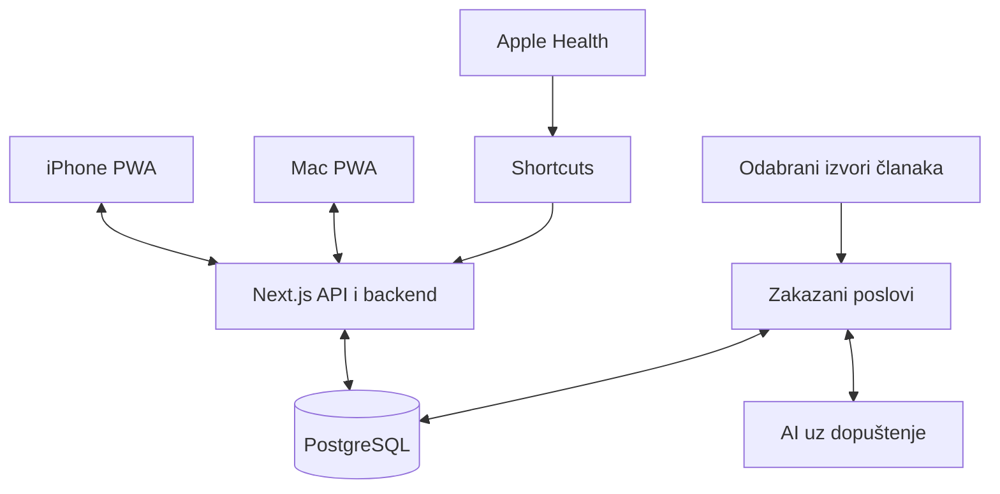

# Personal API — početak projekta

Datum: 15. listopada 2026. Ovaj dokument čuva ciljeve, istraživanje i dogovorenu arhitekturu. Početna verzija radi bez Apple Developer članarine.

## 1. Namjena i ciljevi

Aplikacija je zasad privatna i služi jednom korisniku. Koristi se na iPhoneu 17 / iOS-u 26 i MacBooku Pro M4. Većinu podataka želimo automatizirati; ručni rad svesti na pokretanje timera i kratke unose. Funkcionalnost i jednostavan unos prethode završnom vizualnom dizajnu. Javni launch i podrška drugim korisnicima nisu dio početnog postavljanja.

| Područje | Cilj |
|---|---|
| Društvene mreže | Manje od 60 minuta dnevno; upozorenje nakon 60 minuta |
| Učenje / side projekti | Najmanje 180 minuta dnevno, pauze se ne računaju |
| San | Odlazak do 01:00–01:30, buđenje 09:00–10:00, 7–9 sati sna |
| Fitness | Koraci, kratki treninzi, težina, procjene potreba, grafovi |
| Večernje čitanje | Jedan zanimljiv tekst s jasnim završetkom |
| AI | Objašnjenje trendova i prijedlozi uz dopuštenje |

Početne postavke: 180 minuta učenja, 60 minuta društvenih mreža, 8.000 koraka (podesiva početna vrijednost), san 7–9 sati, cilj spavanja 01:00 i buđenja 09:30. Fitness cilj, dob, visina i drugi osobni podaci unose se u postavkama; aplikacija ih ne izmišlja.

## 2. Treba li dodatni uređaj?

Za početak ne treba Fitbit niti pametni sat. iPhone bilježi korake i procjenjuje aktivnu energiju dok ga nosiš. Za težinu je dovoljna obična vaga, a trening se bilježi vrstom i trajanjem. Bez nosivog uređaja san se potvrđuje ujutro. Vrijeme u krevetu, procijenjeno spavanje i faze sna različite su kategorije.

Apple opisuje procjenu koraka i energije pomoću iPhoneovih senzora: [Fitness na iPhoneu](https://support.apple.com/en-ie/guide/iphone/iph4c34a8a95/ios). Potrošnja za trening snage bez odgovarajućeg izvora može nedostajati; nedostajući podatak ne znači nula.

Fitbit Air ostaje TODO. Google ga je predstavio u svibnju 2026.: [službena objava](https://blog.google/products-and-platforms/devices/fitbit/fitbit-air/). Budući put podataka je Fitbit → Google Health → Apple Health → naš uvoz. Google dokumentira prijenos koraka, aktivne energije, treninga i sna: [tablica kategorija](https://support.google.com/googlehealth/answer/17037331). Stvarnu dostupnost i uklanjanje preklopljenih izvora treba provjeriti na uređaju.

Izravni Google Health API razmatra se tek ako most preko Apple Healtha ne pokriva potrebne podatke. Google je u prijelazu sa starog Fitbit Web API-ja: [aktualna dokumentacija](https://developers.google.com/health). Ne graditi novu ovisnost o starim Fitbit endpointima; ponovno provjeriti pristup novim projektima pri implementaciji.

## 3. Odakle dolaze podaci?

| Podatak | Početni izvor | Ručni dio |
|---|---|---|
| Koraci, aktivna energija | Apple Health preko Shortcutsa | Pokretanje sinkronizacije ako automatizacija nije pouzdana |
| Trening | Brzi unos | Vrsta i trajanje |
| Težina | Vaga i obrazac | Unos kg |
| San | Jutarnji unos | Odlazak u krevet, buđenje, kvaliteta i budnost |
| Hrana | Dnevni ukupni unos | Kalorije i proteini; uređaj ne zna što si pojeo |
| Učenje | Namjerno pokrenut timer | Start, pauza, završetak i eventualni ispravak |
| Društvene mreže | Ugrađeni Screen Time | Dnevni zbroj ako ga želiš u našim grafovima |
| Čitanje | Odabrani izvori | Interesi i oznaka pročitano |

### Učenje

Programiranje, čitanje, tečaj, predavanje i praktičan projekt mogu pripadati učenju ako ih označiš. YouTube nije automatski produktivan: namjera konkretne sesije određuje kategoriju. Netflix/HBO predstavljaju zabavu. Timer mjeri prijavljeno vrijeme, ne može dokazati da si nešto naučio. Opcionalna bilješka „Što sam naučio?” pomaže pri tjednom pregledu.

ActivityWatch može kasnije dopuniti podatke o aktivnim aplikacijama na Macu: [watcheri](https://docs.activitywatch.net/en/latest/watchers.html). Korištenje aplikacije i neaktivnost tipkovnice nisu isto što i fokusirano učenje; video i čitanje mogu biti korisni bez unosa. Zato pasivno praćenje ne zamjenjuje timer.

### Društvene mreže i Apple članarina

Ugrađeni Screen Time omogućuje limite i noćni raspored bez naše članarine: [Appleove upute](https://support.apple.com/en-ae/guide/iphone/iphb0c7313c9/ios). Postavi zajednički limit za odabrane mreže i večernji raspored; naše sučelje ne može samo uključiti iPhone blokade. Focus način koji utišava obavijesti nije blokiranje aplikacija.

Vlastita nativna integracija preko Family Controls / Device Activity / Managed Settings zahtijeva odgovarajuće mogućnosti računa: [Family Controls](https://developer.apple.com/documentation/xcode/configuring-family-controls). Plaćeni Apple Developer Program iznosi 99 USD godišnje ili lokalnu cijenu; distribucijska dopuštenja traže dodatnu obradu. Besplatno razvojno potpisivanje istječe za sedam dana: [ograničenja računa](https://developer.apple.com/help/account/basics/about-your-developer-account).

Standardni `DeviceActivityReport` prikazuje podatke u izoliranoj ekstenziji i nije opći izvor za naš server: [dokumentacija](https://developer.apple.com/documentation/deviceactivity/deviceactivityreport). Od iOS-a 26.4 postoji zaseban dopušteni izvoz, uz `approvedWithDataAccess`, dodatni entitlement i uvjete lokacije/računa za EU: [izvoz](https://developer.apple.com/documentation/deviceactivity/deviceactivitydata/activitydata%28filteredby%3Ausing%3A%29). To ostaje moguća kasnija nativna nadogradnja, ne mogućnost web aplikacije.

Eksperimentalni Mac importer čita iCloud-sinkronizirane Biome podatke, uz Full Disk Access i dokumentirana ograničenja: [ActivityWatch importer](https://github.com/ActivityWatch/aw-import-screentime#limitations). Ne ovisiti o njemu za osnovnu funkcionalnost ili blokiranje.

### Procjene fitnessa

Odvojeno čuvamo unesene kalorije, aktivnu energiju i procijenjene potrebe. Energija s uređaja nije automatsko jednako povećanje dopuštenog unosa hrane. Istraživanja pokazuju ograničenja procjene energije; rezultati starijih uređaja ne predstavljaju test Fitbita Air: [primarno istraživanje](https://pubmed.ncbi.nlm.nih.gov/28538708/).

Početna procjena potrošnje u mirovanju koristi Mifflin–St Jeor, s težinom, visinom, dobi i spolnim parametrom formule: [izvorni rad](https://pubmed.ncbi.nlm.nih.gov/2305711/). Procjena održavanja uključuje odabranu razinu aktivnosti bez ponovnog dodavanja iste aktivnosti. Bez potrebnog profila rezultat se ne prikazuje. Trend težine i dovoljno potpun unos hrane trebaju prethoditi prilagodbi; korisnik potvrđuje promjene. [NIH Body Weight Planner](https://www.niddk.nih.gov/bwp).

Proteinski raspon 1,4–2,0 g/kg služi kao opća referenca za zdrave osobe koje vježbaju, uz jasno označenu metodu: [ISSN](https://pmc.ncbi.nlm.nih.gov/articles/PMC5477153/). Body fat ne proizlazi iz same težine. Moguće je unijeti rezultat mjerenja ili procjenu RFM iz visine, opsega struka i parametra formule: [RFM istraživanje](https://pubmed.ncbi.nlm.nih.gov/30030479/). Procjene nisu dijagnoza.

## 4. Iskustva drugih i kritičko mišljenje

- [theKovahov dashboard](https://www.reddit.com/r/QuantifiedSelf/comments/1h5yzc8/finally_set_up_syncing_my_apple_health_records_to/): Laravel Filament, Health Auto Export i HTTP uvoz. Autor je u naknadnoj nadopuni opisao da izravni HTTP radi uz postavke i ponavljanje zahtjeva. Pouka: ponavljanje, izbjegavanje duplikata i status uvoza.
- [HPI](https://beepb00p.xyz/hpi.html): zamjenjivi konektori i sačuvani izvozi omogućuju ponovnu obradu. Pouka: izvoz podataka i jasni izvori.
- [Rasprava o previše praćenja](https://www.reddit.com/r/QuantifiedSelf/comments/1i5pfo7/overkill_quantified_self_tracking/): autor Retool/PostgreSQL trackera opisuje zamor od unosa, a drugi sudionici smanjenje broja dnevnih polja. To su osobna iskustva, ne dokaz korisnosti ili beskorisnosti praćenja.
- [Health Data Hub](https://github.com/tkuennen/health-data-hub): strukturirani pokazatelji prije AI objašnjenja. Preuzimamo taj princip uz jednostavniji sustav za jednog korisnika.

Moje mišljenje: najvažniji su održiv dnevni unos i pouzdana sinkronizacija. Jednom tjedno pregledaj cilj i izaberi jednu promjenu navike. AI može ukazati na povezanost, ali mali osobni uzorak ne dokazuje uzrok. Završni dizajn dolazi nakon korištenja funkcionalne verzije; brzina unosa i čitljivost važni su od početka.

## 5. Arhitektura od početka

Frontend je ono što vidiš; backend obrađuje zahtjeve; API je način komunikacije; baza trajno čuva podatke. Server je računalo na kojem rade serverski programi.

### Frontend

React gradi dijelove sučelja, TypeScript opisuje očekivane podatke, Next.js organizira stranice i API, CSS određuje izgled. Jedno responzivno sučelje radi na oba uređaja. PWA dobiva ikonu, instalaciju i podršku za odabrane offline radnje. [Next.js PWA](https://nextjs.org/docs/app/guides/progressive-web-apps).

IndexedDB čuva neposlane unose i posljednji dostupni pregled. Korisnik vidi „čeka slanje” ili „sinkronizirano”. Sinkronizacija se ponovno pokušava dok je aplikacija otvorena i veza dostupna. Čišćenje podataka preglednika može obrisati neposlane zapise: lokalna pohrana nije sigurnosna kopija.

### Backend

Jedan modularni monolit dijeli kod na račun, učenje, fitness, san, prehranu, integracije i sadržaj. Next.js Route Handlers izlažu privatni JSON API. Node.js izvršava serverski kod. Jedan projekt olakšava održavanje; jasne cjeline olakšavaju izmjene.

API provjerava pristup i stvarne ulazne podatke. Jedan privatni račun, Argon2id lozinka, nasumične opozive sesije, HttpOnly kolačić, zaštita od cross-site zahtjeva i ograničenje pokušaja prijave. Integracijski ključ dopušta samo Health uvoz; u bazi se čuva njegov hash.

### Baza

PostgreSQL čuva povezane zapise s datumom, vrijednošću, jedinicom, izvorom i oznakom procjene. Glavna baza zajednička je uređajima. Uvoz je idempotentan: isti zapis ili dnevni zbroj ne dodaje se dvaput. Prazno nije nula.

### Timer

Čuvamo početak, kraj, pauze i verziju sesije. Frontend prikazuje proteklo vrijeme iz tih oznaka, ne ovisi o pouzdanosti sekunde po sekunde u pozadini. Jedna aktivna sesija po računu; zastarjele ili konfliktne radnje se odbijaju i korisnik osvježava stanje. Preklopljena vremena ne broje se dvaput. Dnevni zbroj poštuje vremensku zonu.

### Health uvoz

Shortcuts uz dopuštenje čita potrebne zapise i šalje JSON našem API-ju. Početni format i postupak nalaze se u docs/shortcuts.md i docs/api.md. [Čitanje](https://support.apple.com/en-il/guide/shortcuts/apd3c845e881/ios), [HTTP zahtjevi](https://support.apple.com/en-az/guide/shortcuts/apd58d46713f/ios). Pozadinsko čitanje i zaključan uređaj ograničavaju automatizaciju; uvijek postoji ručno pokretanje.

### Worker i AI

Zaseban proces iz istog projekta dohvaća unaprijed odabrane RSS izvore, priprema dnevni članak i tjedni sažetak. Tekstovi se prikazuju kao naslov, dopušteni kratki opis i izvorna poveznica; nema beskonačnog feeda.

Program izračunava pokazatelje, AI ih objašnjava. Vanjski pozivi zahtijevaju konfiguriran servis i izričitu dozvolu. Ključ ostaje na serveru, trošak se ograničava, a prekid AI servisa ne zaustavlja unose/timer/grafove. Nema automatskog mijenjanja kalorija ili rasporeda. Vanjski servisi nisu kupljeni niti uključeni samom instalacijom.

### Hosting i sigurnosne kopije

Lokalni razvoj koristi Mac i Docker PostgreSQL. Kad Mac spava, backend nije dostupan. Za svakodnevni pristup s bilo kojeg mjesta potreban je stalan server. Docker Compose pokreće aplikaciju, bazu, worker i Caddy HTTPS. Podaci imaju trajni disk i zasebne šifrirane kopije. Javni URL ne znači javni pristup podacima.

## 6. Provjera i daljnji rad

Provjeriti prijavu i zabranu pristupa bez nje, prijenos između uređaja, pauze i zatvaranje timera, offline red, odbijanje duplikata i konflikata, izvore i zastarjele podatke, odbijanje AI-ja bez dozvole te povrat sigurnosne kopije.

TODO: nativni iPhone i vlastito blokiranje, Fitbit nakon kupnje, napredniji unos hrane/barkodovi, detaljnije pasivno praćenje Maca, završni vizualni identitet, eventualni drugi korisnici. Hosting i AI imaju zasebne troškove; početni predloženi AI limit je 5 € mjesečno, a to nije procjena zajamčenog broja poziva.

Aktualne upute za pokretanje i stvarno implementirane mogućnosti nalaze se u README.md. Ovaj dokument ne predstavlja tvrdnju da su TODO integracije izvedene ili provjerene na fizičkom iPhoneu.
